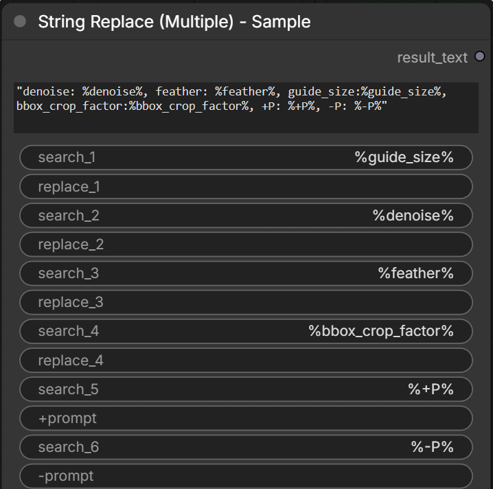

## ComfyUI-MDSNodes

the following custom nodes was build to use with The Ultimate Model Tester Workflow [civitai link](https://civitai.com/articles/33496/the-ultimate-model-tester-workflow) . They may also be useful for your own workflows.

## Nodes

- **Load Image (With Path)** 
  Loads an image and outputs its decoded IMAGE, MASK, filename, full_path, and directory.

- **Top Upscale Models Selector (Auto-DL)** 
  Selects top upscale models (e.g., 4x-UltraSharp, 4xRealWebPhoto) and auto-downloads missing files when queued.

- **ControlNet Select** 
  Selects a ControlNet model and outputs its filename as both a standard string and a wildcard/combo connection.

- **Select Diffusion Model** 
  Selects a UNET/Diffusion model and passes its filename as CKPT_NAME and UNET_NAME (useful for context routing).

- **UNet Name to CKPT Name** 
  Routes a UNET model filename into nodes expecting CKPT_NAME (such as rgthree context nodes).

- **Ratio Combobox**
  Dropdown of common percentage presets (10%, 25%, 50%, 100%) converted directly into decimal FLOAT values (e.g., 0.5).

- **Central parameter hub**
  Configures and routes checkpoint, steps, refiner steps, CFG, sampler algorithm, scheduler curve, and denoise values across workflows.

  

- **Load Checkpoint Hub Pro and Load Diffusion Model Hub Pro**

  Central parameter hub that loads a checkpoint/Diffusion Model and routes MODEL, CLIP, VAE, steps, refiner steps, CFG, sampler algorithm, scheduler curve, denoise values, positive/negative prompts, and metadata across workflows. Also, the model AutoV2 hash (used by Civitai) will be added to the metadata 

  

- **Strings Nodes:**
  
  **Merge Two Strings**: Merges two strings with an optional delimiter if both strings are not empty. Handles None or missing inputs as an empty string.
  
  **Convert to String**: Converts any incoming data type safely into a standard string.

- **MetaData Nodes:**
  
  **MetaData Append**: Merges two strings with an optional delimiter if both strings are not empty. Handles None or missing inputs as an empty string.
  
  **MetaData Remove**: Converts any incoming data type safely into a standard string.
  
  **MetaData Extract**: Merges two strings with an optional delimiter if both strings are not empty. Handles None or missing inputs as an empty string.
  
  **MetaData Convert to EXTRA_METADATA**: Converts any incoming data type safely into a standard string.
  
## Requirements
No extra packages required. Works out-of-the-box with standard ComfyUI dependencies.

## Installation
Install via ComfyUI Node Manager: Search `ComfyUI-MDSNodes` in ComfyUI Node Manager and click the Install button.
